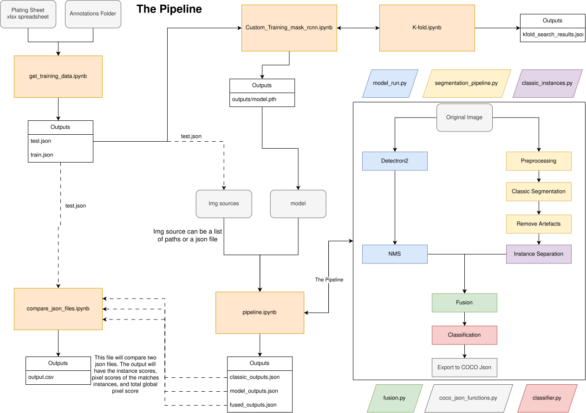

# DAAD_Tristan_Bioinformatics_2026

<!-- 
Acknowledgements:
This work is being done for the university of Potsdam, with supervison from Boyana Kozhuharova and aid from Mellanie Martin -->


the main file is pipeline.ipynb which includes example runs. Please note that your system must have all the correct requirements included in the requirements.txt file. You must also take note that facebook's Detectron 2 model is native to Linux and MacOS. If you are using a windows computer you will need to install Detectron2 through another service.

The most important file in this repository is **pipeline.ipynb**. This program conatains code for the *instance_segmentation_pipeline()* function which will point you to all the files and functions that run the entire segmentation pipeline. Another important function is *make_coco_outputs()* which will run the segmentation function and output to json format. Example uses are stored at the end of the pipeline.ipynb. Please note that not all code is doccumented at the moment. 

There are 2 main ways to use this program:

1.) Runs from file paths parsed in by you

```
# in pipeline.ipynb
image = "/home/mellanie/Desktop/Annotated_dataset/20241002_N4_Plate1_DAG6_1000_L/000007.tif"
fused_classified_instances, model_instances, classic_masks = instance_segmentation_pipeline(image, verbose=False)
```

2.) Runs from a json file containing image paths and their corresponding labelme annotations 

```
# in pipeline.ipynb
json_file = "/home/mellanie/Desktop/Tristan_2026_code/detectron2/training&testing_data/model2.5_data/genotypes_at_end_of_Tristan's_term/test.json"
make_coco_outputs(json_file) # calls instance_segmentation_pipeline()
```

As you can see below in this figure, once you have your outputs from **pipeline.ipynb** (bottom center) you can feed them into **compare_json_files.ipynb** to recieve csv files based on the analysis of predicted segments compared to the annotated labelme segemnts.



In the compare_json_files.ipynb file you will see a config cell. Keep in mind you will only have comparisons if the image you're analyzing already had labelme annotations. For example, if you were running the pipeline on unannotated images, you would have no reason to proceed further here. 

the GT_JSON should be the same json file you used in **pipeline.ipynb** to generate your predictions. The PRED_JSON path will be the direct output you got from the piepline. You should have 3 paths at your disposal, FUSION_OUTPUT, MODEL_OUTPUT, and FUSION_OUTPUT. If you don't know what or where these are, check the bottom of the config cell in pipeline.ipynb.

For the example above, this would be the configuration:
```
# in compare_json_files.ipynb
GT_JSON   = "/home/mellanie/Desktop/Tristan_2026_code/detectron2/training&testing_data/model2.5_data/genotypes_at_end_of_Tristan's_term/test.json"
PRED_JSON = "/home/mellanie/Desktop/Tristan_2026_code/outputs/model2.5_final_23_genotypes.json"
```


There are also some optional configurations that I reccomend not touching whith the exception of IS_FUSED, which should be True if and only if you're using the FUSED_OUTPUT path:

```
# in compare_json_files.ipynb
IOU_THRESHOLD = 0.50 # use 0.50 for standard COCO; 0.35 suits thin root-hair structures
OUTPUT_CSV = "analysis/csv_data_for_analysis/final_model_output_no_tangles.csv"
IS_FUSED = False
```

Your OUTPUT_CSV path, assuming everything goes well, should be a final table with all of the runs output statistics. 

| genotype | instance_precision | instance_recall | instance_f1 | pixel_precision | pixel_recall | pixel_f1 | global_pixel_precision | global_pixel_recall | global_pixel_f1 |
|----------|-------------------:|----------------:|------------:|----------------:|-------------:|---------:|-----------------------:|--------------------:|----------------:|
| Bay-0    | 0.7465 | 0.6795 | 0.7114 | 0.8408 | 0.8507 | 0.8457 | 0.8416 | 0.6832 | 0.7542 |
| Col-0\*  | 0.7439 | 0.8472 | 0.7922 | 0.8833 | 0.8390 | 0.8606 | 0.8407 | 0.8129 | 0.8266 |
| Cvi-0    | 0.7597 | 0.6393 | 0.6944 | 0.8077 | 0.8637 | 0.8348 | 0.8212 | 0.7126 | 0.7630 |
| ...    | ... | ... | ... | ... | ... | ... | ... | ... | ... | 
| TOTAL | 0.7236 | 0.6042 | 0.6585 | 0.8544 | 0.8000 | 0.8263 | 0.8423 | 0.5553 | 0.6693 |


I have rounded the numbers to 4 decimal places in this example. This example csv would contains all the necessary information to build plots displaying statistics for the model's final performance.

A note on definitions:
instance based: for all root hair instances, how many were found?
pixel based: within matched instances, how many pixels are right?
global based: for all pixels on the image, how many pixels are right?
total: micro-average of all genotype scores